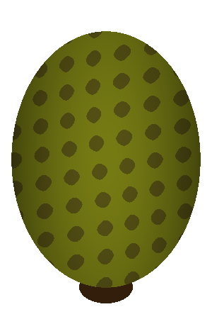
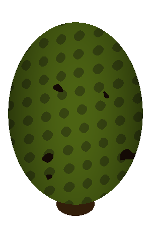
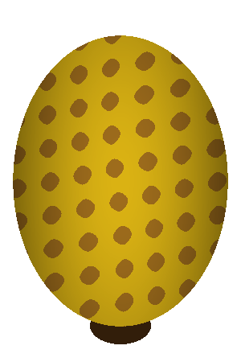
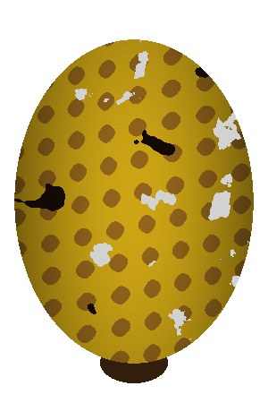
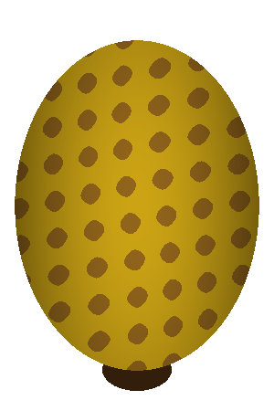
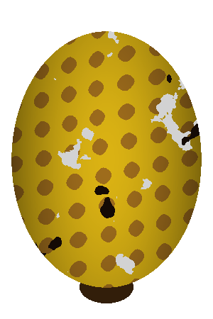

# Procedural Synthetic Pineapple Data Generator 🍍

An interactive procedural data generator developed to address the **annotated data bottleneck** in computer vision models for automated fruit quality inspection and defect grading of pineapples (*Ananas comosus*).

This project procedurally synthesizes realistic pineapple images across diverse ripeness stages with customizable defect patterns (such as white fungus and black spots) using mathematical modeling and Perlin noise.

---

## 📖 Overview

Automated quality grading in agricultural computer vision (e.g., using YOLO architectures) requires large, diverse, and well-annotated datasets. However, capturing thousands of physical samples covering every combination of ripeness and defect type is labor-intensive, costly, and subject to human fatigue.

This repository provides an end-to-end procedural synthesis pipeline and Streamlit application that enables:
1. **Geometric & Anatomical Synthesis**: Hexagonal/diamond grid scale patterning ("eyes") with 3D cylindrical/spherical warp modeling and 2.5D shading.
2. **Ripeness Spectrum Interpolation**: Continuous color gradient transitions representing Unripe (green), Ripe (golden-yellow), and Overripe (dull brown) stages.
3. **Procedural Defect Modeling**: Dynamic synthesis of white fungus (*Thielaviopsis paradoxa*) and black rot spots using multi-octave 2D Perlin noise with adaptive percentile thresholding.
4. **Automated Batch Dataset Generation**: Domain randomization across noise scale, defect placement, and dimensions with direct ZIP export for classification or object detection pipelines.

---

## 🖼️ Sample Outputs

| Category | Healthy | With White Fungus / Black Spots |
| :--- | :---: | :---: |
| **Unripe** |  |  |
| **Ripe** |  |  |
| **Overripe** |  |  |

---

## 🛠️ Features & Methodology

### 1. Procedural Scale & Texture Generation
Instead of naive random Voronoi diagrams, a structured sinusoidal grid is warped across vertical and horizontal curvature axes:
$$\text{diag}_1 = \sin\left(\frac{x_{\text{warped}} + y_{\text{warped}}}{s} \cdot 2\pi\right), \quad \text{diag}_2 = \sin\left(\frac{x_{\text{warped}} - y_{\text{warped}}}{s} \cdot 2\pi\right)$$
The intersection creates a structured diamond checkerboard mimicking real pineapple eye anatomy.

### 2. Multi-Octave Perlin Noise for Defects
- **White Fungus**: Generated with higher persistence and frequency noise, thresholded dynamically at the 95th percentile to create natural fuzzy fungal clusters.
- **Black Spots**: Configured with independent octaves and higher percentile cutoff (98th percentile) to simulate sporadic rotting spots.

### 3. Domain Randomization & Batch Export
When exporting datasets, the tool introduces randomized scaling jitter, defect probabilities, and coordinate shifts to ensure diversity for machine learning training.

---

## 🚀 Getting Started

### Prerequisites

- Python 3.8 or higher
- `pip` package manager

### Installation

1. Clone this repository:
   ```bash
   git clone https://github.com/MrCrahb/fyp-pineapple-defect-detection.git
   cd fyp-pineapple-defect-detection
   ```

2. Create and activate a virtual environment (optional but recommended):
   ```bash
   python3 -m venv venv
   source venv/bin/activate  # On Windows: venv\Scripts\activate
   ```

3. Install the dependencies:
   ```bash
   pip install -r requirements.txt
   ```

### Running the Generator Application

Launch the Streamlit web dashboard:
```bash
streamlit run app.py
```

The application will open in your default browser (usually at `http://localhost:8501`).

---

## 🎛️ Application Features

- **Live Preview & Tuning**:
  - Adjust ripeness slider ($0.0 = \text{Unripe}$ to $1.0 = \text{Overripe}$).
  - Toggle defect layers (White Fungus, Black Spots).
  - Tune Perlin noise octaves, scale, persistence, and lacunarity in real-time.
- **Dataset Synthesis Engine**:
  - Specify target sample counts for each category (`unripe`, `ripe`, `overripe`).
  - Configure defect occurrence probabilities.
  - Export generated images bundled in a structured `.zip` archive.

---

## 📊 External Benchmark Dataset

For real-world baseline comparison and transfer learning experiments (such as YOLOv8 evaluation), the model benchmark dataset is hosted publicly on Roboflow Universe:
- **Roboflow Dataset**: [Pineapple Defect Detection 2 (v7)](https://universe.roboflow.com/kugan-6pdgq/pineapple-defect-detection-2/dataset/7) (Annotated YOLOv8 format, CC BY 4.0).

---

## 📁 Repository Structure

```
fyp-pineapple-defect-detection/
├── app.py              # Main Streamlit application and procedural generation pipeline
├── requirements.txt    # Python dependencies (Streamlit, NumPy, Pillow, noise)
├── samples/            # Sample synthetic pineapple images across ripeness and defect classes
├── .gitignore          # Git exclusion rules
├── LICENSE             # MIT License
└── README.md           # Documentation and project overview
```

---

## 📄 License

This project is licensed under the [MIT License](LICENSE).
